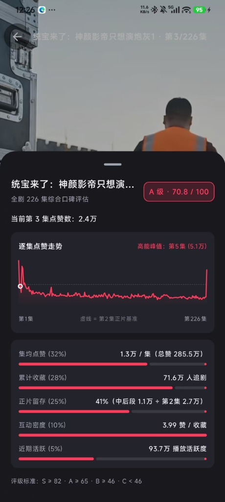

<div align="center">
  
  <h1>皮果刷剧</h1>
  <p><strong>仅 3.6 MB · 彻底零广告 · 用真实数据帮你筛出好剧的纯净 Android 刷剧 App</strong></p>
  <p>
    无开屏无贴片广告 · 无商城/无小游戏/无领金币 · 安装包仅 3.6 MB · S/A/B/C 数据选好剧 · 开源免费
  </p>
  <p>
    <a href="https://github.com/xscanzm/piguo-drama/releases/latest"><strong>👉 前往 Releases 下载最新版 APK（仅 3.6 MB）</strong></a>
  </p>
</div>

---

## 为什么换用「皮果刷剧」？

刷短剧本来是为了图个轻松爽快，但大多数同类 App 打开先看几秒开屏广告，看两集又弹出看广告解锁、逛商城、做任务领金币、玩小游戏……

**「皮果刷剧」把这些干扰全部砍掉，只保留最核心、最顺手的一件事：痛快选好剧、安静刷全集。**

### 1. 彻底无广告，打开即看
- 没有开屏倒计时、没有片头贴片、没有“看 30 秒广告解锁下一集”，更没有各种诱导点击弹窗。
- 打开 App 就是全屏短剧，上下滑动直接切换，播完自动连播下一集。

### 2. 纯粹刷剧，零臃肿功能
- **没有商城、没有小游戏、没有刷金币红包、没有花哨推广页**。
- 界面清爽直观，长辈拿在手里也能一秒上手，只为安安静静看剧服务。

### 3. 极致轻巧，安装包仅 3.6 MB
- 对比动辄两三百 MB 的常规视频客户端，**安装包体积仅约 3.6 MB**，小了几十倍。
- 几秒钟就能下载装好，几乎不占手机存储，低配老手机刷剧也同样轻快省电。

### 4. 用真实播放与点赞数据挑好剧，拒绝踩雷与烂尾
不用盲猜哪些剧好看。「皮果刷剧」直接拉取每部剧从第 1 集到结局的**真实互动数据**（集均点赞、累计追剧人数、中后段正片留存率、互动密度与近期活跃度），实时算出 **S / A / B / C 口碑等级**：

- **一眼看清剧集质量**：评分徽章与核心数据（本集赞、追剧人数、正片留存率）直接独立展示在剧名上方，好不好看一眼有数。
- **一键筛掉低分烂剧**：首页顶部点一下即可切换 **「全部 / 去C级 / 仅A/S」**，只把时间留给高口碑好剧。
- **防烂尾自动熔断**：有些剧前两集全靠“强钩子”骗流量，后面疯狂注水掉粉；系统一旦发现尾段留存过低，会自动扣分封顶，绝不误推成 S 级。
- **提前挖出黑马宝藏剧**：还在起量但后劲十足、留存率 ≥ 45% 的黑马剧会自动打标高亮，先人一步追到宝藏。
- **逐集点赞走势 & 高能集标红**：点一下剧名上方的评分条，就能看清整部剧每一集的热度曲线和最炸裂的高能集，选集再也不用盲点。

<div align="center">
  
  <p><em>实机效果：点击评分条即可查看逐集点赞走势图、高能集峰值与五维数据拆解</em></p>
</div>

### 5. 为追剧党打磨的贴心细节
- **画中画小窗**：切出去回微信、刷别的应用时，小窗继续播，剧情不断档。
- **息屏听剧 + 定时关闭**：通勤或睡前闭眼听剧，可设「播完本集」或 `15 / 30 / 60 分钟` 自动停止，睡着也不耗电。
- **全屏防误触锁屏 + 画面比例切换**：躺着单手看剧一键锁屏防误触，支持「满屏沉浸 / 完整显示不裁边」，倍速与清晰度随时调整。
- **支持同步原账号进度**：不用登录就能直接看；如需同步历史追剧列表和观看进度，也支持登录原有账号一键同步。

---

## 下载与安装

- **系统要求**：Android 8.0 及以上手机
- **下载方式**：打开 [Releases 发布页](https://github.com/xscanzm/piguo-drama/releases/latest) → 下载 `piguo-drama-v1.0.1.apk`（文件名 `app-release.apk`，仅约 `3.6 MB`）安装即可使用。

---

## 加入微信交流群 · 提需求 / 聊好剧

想加什么实用小功能、遇到哪些片源或适配问题，或者想一起交流真正值得追的 **S 级宝藏短剧**，欢迎扫码进群直接告诉我们！

<div align="center">
  
  <p><em>微信扫一扫加入「边coding边看剧」交流群（二维码 7 天内即 11 月 27 日前有效，如过期可在 <a href="https://github.com/xscanzm/piguo-drama/issues">Issues</a> 留言更新）</em></p>
</div>

---

<details>
<summary><strong>开发者自行编译 / 构建说明（普通用户无需关心）</strong></summary>

### 环境要求
- JDK 17
- Android SDK（`compileSdk = 36`、`minSdk = 26`、`targetSdk = 35`）
- 在仓库根目录创建 `local.properties` 并配置本机 SDK 路径：
  ```properties
  sdk.dir=D\:\\Android\\Sdk
  ```

### 常用命令

```powershell
# 运行本地协议与口碑评分单元测试
.\gradlew.bat :app:testDebugUnitTest --no-daemon

# 构建 Debug APK
.\gradlew.bat :app:assembleDebug --no-daemon

# 构建 Release APK（已启用 R8 混淆与资源压缩）
.\gradlew.bat :app:assembleRelease -x lintVitalRelease -x lintVitalAnalyzeRelease --no-daemon
```

产物输出路径：`app/build/outputs/apk/release/app-release.apk`。

</details>

---

## 作者与开源声明

- **作者**：皮皮未来 · 周一 · xscanzm
- **功臣**：Gemini
- **开源协议**：基于 GNU General Public License v3.0（`GPL-3.0-only`）开源，许可证全文见 [LICENSE](LICENSE)，上游协议适配与修改声明见 [NOTICE](NOTICE)。
- **免责声明**：本项目仅用于个人学习与移动端技术研究，所有影视内容及相关权益归原平台与版权方所有。
